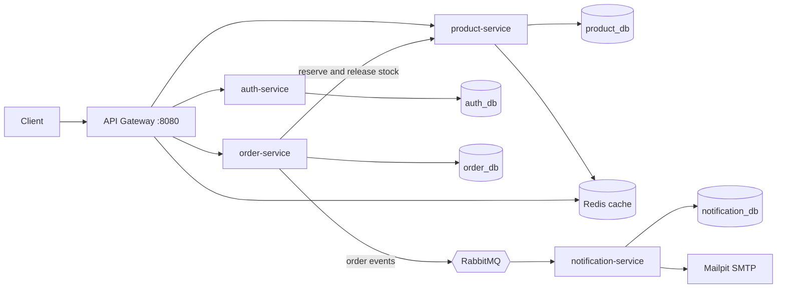
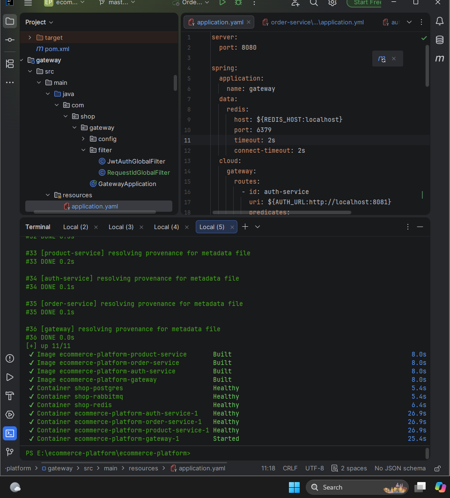
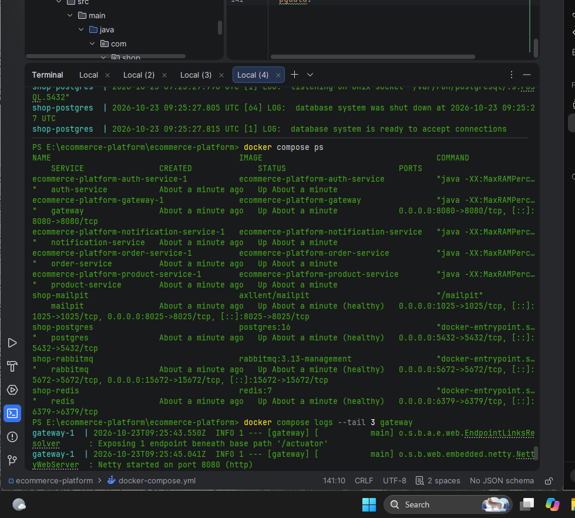
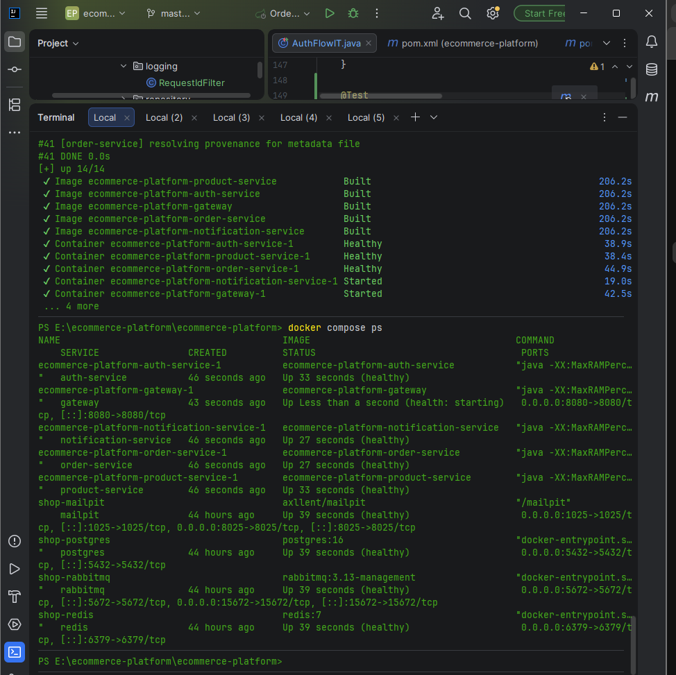
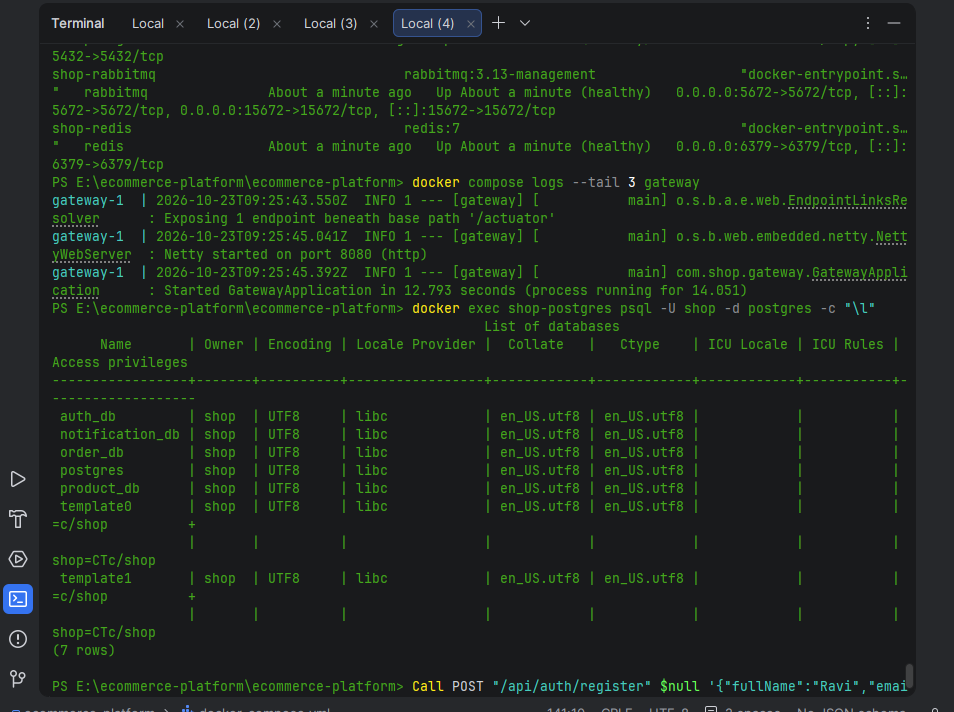
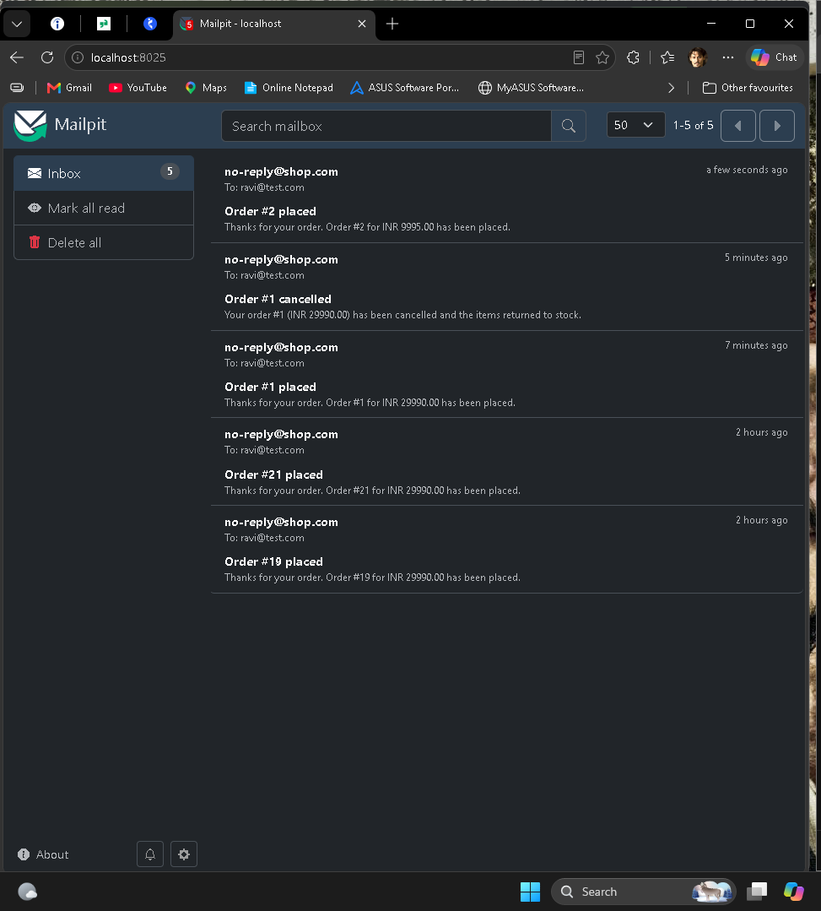
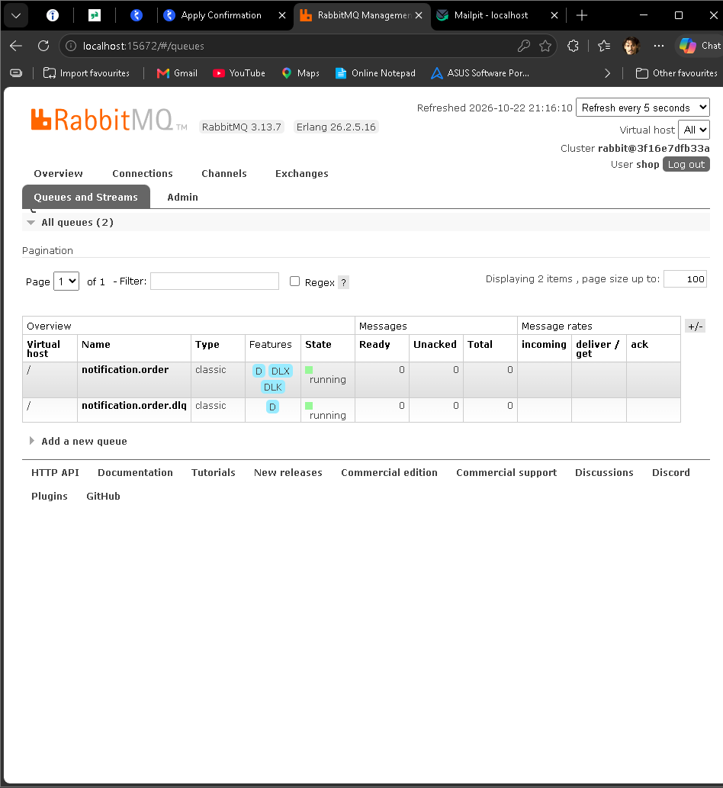
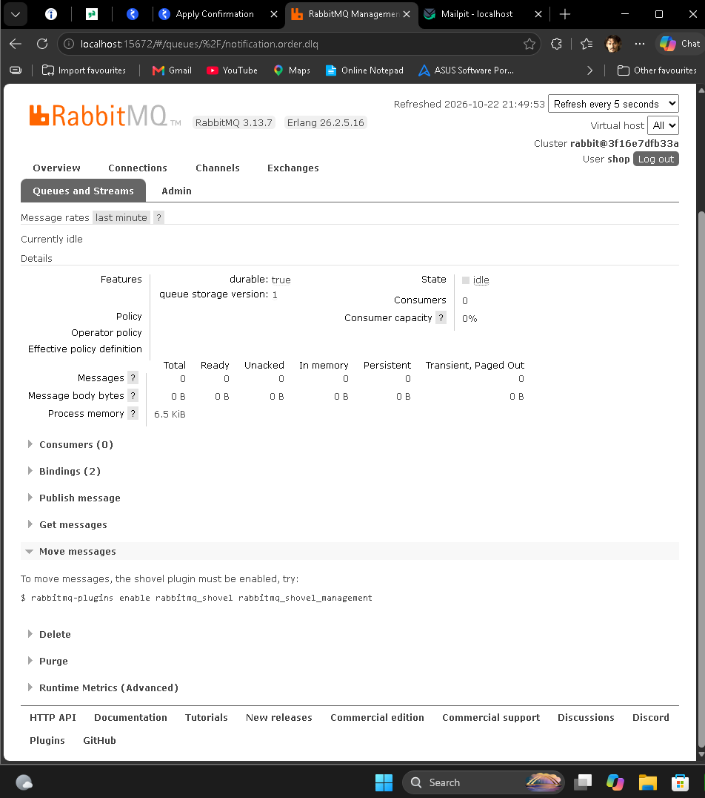
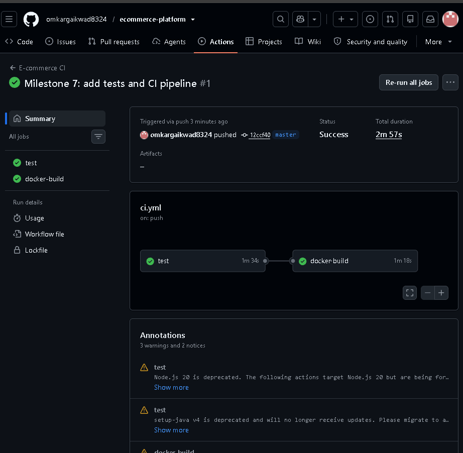

# E-Commerce Microservices Platform


A backend e-commerce platform built as five Spring Boot microservices behind an API gateway. The whole stack starts with one `docker compose up`.

## Architecture



Only the gateway is published to the host. All other services are reachable only inside the Docker network.

## Screenshots

### Running stack (Docker Compose)

| Services healthy | Services healthy (view 2) | Services healthy (view 3) |
| --- | --- | --- |
|  |  |  |

### Order flow through the gateway



### Order emails (Mailpit)



### RabbitMQ queues and dead-letter queue

| Queues | Queues (view 2) |
| --- | --- |
|  |  |

### CI: tests plus a Docker build for every service



## Services

| Service | Port (internal) | Responsibility |
| --- | --- | --- |
| gateway | 8080 (published) | JWT validation, trusted identity headers, Redis rate limiting, request id, routing |
| auth-service | 8081 | Register, login, refresh tokens, roles, lockout |
| product-service | 8082 | Catalog CRUD, search, Redis cache, atomic stock reserve and release |
| order-service | 8083 | Checkout, cancel, status lifecycle, publishes order events |
| notification-service | 8084 | Consumes events from RabbitMQ and sends emails |

## Tech stack

| Area | Technology |
| --- | --- |
| Language and frameworks | Java 17, Spring Boot 3.3, Spring Security, Spring Data JPA, Spring Cloud Gateway |
| Data | PostgreSQL 16 (one database per service), Redis 7 |
| Messaging | RabbitMQ (topic exchange, retries, dead-letter queue) |
| Build and run | Maven multi-module, multi-stage Docker builds, Docker Compose |
| Testing and CI | JUnit 5, Mockito, Testcontainers, GitHub Actions |

## Run it

Requirements: Docker Desktop and Git.

```bash
git clone https://github.com/omkargaikwad8324/ecommerce-platform.git
cd ecommerce-platform
cp .env.example .env
```

On Windows PowerShell use `Copy-Item .env.example .env` instead of `cp`. Open `.env` and set two values:

- `JWT_SECRET`: a random string of at least 32 characters
- `INTERNAL_KEY`: any random string

Start everything (the first build takes several minutes):

```bash
docker compose up -d --build
docker compose ps
```

Wait until the five app services show `(healthy)`.

| URL | What |
| --- | --- |
| http://localhost:8080 | API, through the gateway |
| http://localhost:8025 | Mailpit inbox (order emails) |
| http://localhost:15672 | RabbitMQ UI (user `shop`, password `shop123`) |

Seeded admin for development only: `admin@shop.com` / `Admin@123`.

## Quick try

```bash
# register and log in
curl -X POST localhost:8080/api/auth/register -H "Content-Type: application/json" \
  -d '{"fullName":"Ravi","email":"ravi@test.com","password":"Pass@1234"}'
curl -X POST localhost:8080/api/auth/login -H "Content-Type: application/json" \
  -d '{"email":"ravi@test.com","password":"Pass@1234"}'

# list products and place an order (use the accessToken from login)
curl localhost:8080/api/products -H "Authorization: Bearer <accessToken>"
curl -X POST localhost:8080/api/orders -H "Authorization: Bearer <accessToken>" \
  -H "Content-Type: application/json" -H "Idempotency-Key: demo-1" \
  -d '{"items":[{"productId":1,"quantity":1}]}'
```

Then open Mailpit to see the order email.

## API

| Method and path | Access | Notes |
| --- | --- | --- |
| POST `/api/auth/register`, `/login`, `/refresh`, `/logout` | public | Refresh tokens rotate; reuse revokes all sessions |
| GET `/api/users/me` | user | |
| GET `/api/products`, `/api/products/{id}` | user | Search by `q` and `category`, paged, cached by id |
| POST, PUT, DELETE `/api/products` | admin | Soft delete, optimistic locking |
| POST `/api/orders` | user | `Idempotency-Key` header makes retries safe |
| GET `/api/orders`, `/api/orders/{id}` | owner or admin | |
| POST `/api/orders/{id}/cancel` | owner or admin | Releases stock |
| GET `/api/orders/admin`, PUT `/api/orders/{id}/status` | admin | Status lifecycle is enforced |

## Key design decisions

- **Auth:** 15-minute JWT access tokens, hashed refresh tokens with rotation and reuse detection, BCrypt passwords, role-based access, account lockout, and the same error for unknown email and wrong password.
- **Gateway:** validates the JWT once, strips and re-sets trusted `X-User-*` headers, and applies Redis token-bucket rate limits per route.
- **No overselling:** stock is decremented by one atomic conditional `UPDATE`. A concurrency test shows 30 simultaneous buyers of 10 units produce exactly 10 orders.
- **Orders:** saga-style compensation (reserve per item, release on failure), idempotent checkout, and name and price snapshots on each order item.
- **Events:** order events go to RabbitMQ after the commit. The consumer is idempotent (unique event id), retries 3 times, then dead-letters.
- **Resilience:** a Redis outage falls back to the database, and a broker outage never fails an order.
- **Observability:** one `X-Request-Id` per request appears in every service's logs and travels inside RabbitMQ events. Liveness health checks run in Docker.

## Tests

```bash
mvn verify
```

Runs 32 tests: unit tests (JUnit 5, Mockito) and integration tests against real PostgreSQL and Redis with Testcontainers. Docker must be running. GitHub Actions runs the same command on every push and also builds every service image.

## Project structure

```
ecommerce-platform/
├── pom.xml                  parent (Spring Boot 3.3.6)
├── docker-compose.yml
├── Dockerfile               one multi-stage file, built per module
├── infra/init-db.sql        creates the four databases
├── auth-service/
├── gateway/
├── product-service/
├── order-service/
├── notification-service/
├── docs/screenshots/
└── .github/workflows/ci.yml
```

## Known limitations and next steps

- Events are published best-effort after the commit. A transactional outbox would make delivery guaranteed.
- The product service trusts gateway headers. mTLS or signed internal tokens would harden service-to-service calls.
- Add distributed tracing (OpenTelemetry), metrics (Prometheus and Grafana), and Flyway migrations.
- Add a frontend client.