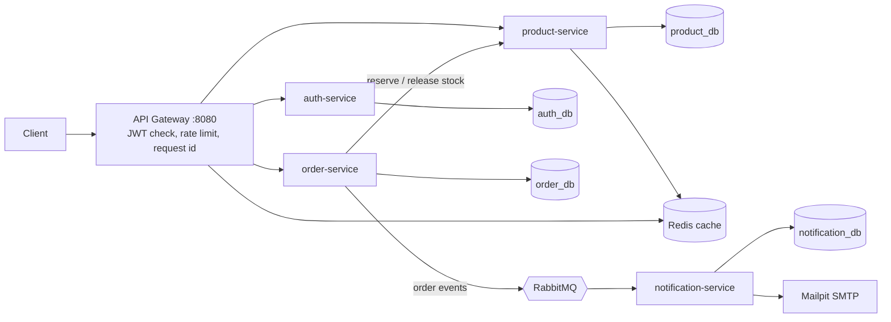

# E-Commerce Microservices Platform


A production-style e-commerce backend built as five Spring Boot microservices behind an API gateway. Runs with a single `docker compose up`.

## Architecture



Only the gateway is published to the host. All other services are reachable only inside the Docker network.

## Tech stack

| Area | Technology |
| --- | --- |
| Language / framework | Java 17, Spring Boot 3.3, Spring Security, Spring Data JPA, Spring Cloud Gateway |
| Data | PostgreSQL 16 (one database per service), Redis 7 |
| Messaging | RabbitMQ (topic exchange, retries, dead-letter queue) |
| Build / run | Maven multi-module, multi-stage Docker builds, Docker Compose |
| Testing / CI | JUnit 5, Mockito, Testcontainers, GitHub Actions |

## Run it

```
cp .env.example .env        # then set JWT_SECRET (32+ chars) and INTERNAL_KEY
docker compose up -d --build
```

| URL | What |
| --- | --- |
| http://localhost:8080 | API (through the gateway) |
| http://localhost:8025 | Mailpit inbox (order emails) |
| http://localhost:15672 | RabbitMQ UI (shop / shop123) |

Seeded admin: `admin@shop.com` / `Admin@123` (development only).

## API

| Method and path | Access | Notes |
| --- | --- | --- |
| POST `/api/auth/register`, `/login`, `/refresh`, `/logout` | public | Refresh tokens rotate; reuse revokes all sessions |
| GET `/api/users/me` | user | |
| GET `/api/products`, `/api/products/{id}` | user | Search by `q`, `category`; paged; cached by id |
| POST, PUT, DELETE `/api/products` | admin | Soft delete, optimistic locking |
| POST `/api/orders` | user | `Idempotency-Key` header makes retries safe |
| GET `/api/orders`, `/api/orders/{id}` | owner / admin | |
| POST `/api/orders/{id}/cancel` | owner / admin | Releases stock |
| GET `/api/orders/admin`, PUT `/api/orders/{id}/status` | admin | Status lifecycle enforced |

## Key design decisions

- **Auth:** 15-minute JWT access tokens, hashed refresh tokens with rotation and reuse detection, BCrypt passwords, role-based access, account lockout, identical errors for unknown email and wrong password.
- **Gateway:** validates the JWT once, strips and re-sets trusted `X-User-*` headers, applies Redis token-bucket rate limits per route.
- **No overselling:** stock is decremented by one atomic conditional `UPDATE`; a concurrency test proves 30 simultaneous buyers of 10 items yield exactly 10 orders.
- **Orders:** saga-style compensation (reserve per item, release on failure), idempotent checkout, price and name snapshots on each order item.
- **Events:** order events go to RabbitMQ after commit; the consumer is idempotent (unique event id), retries 3 times, then dead-letters.
- **Resilience:** Redis outage falls back to the database; broker outage never fails an order.
- **Observability:** one `X-Request-Id` per request, in every service's logs and carried through RabbitMQ events; liveness health checks.

## Tests

```
mvn verify     # unit tests plus Testcontainers integration tests (needs Docker)
```

CI runs this on every push and also builds all Docker images.

## Known limitations and next steps

- Events are published best-effort after commit. A transactional outbox would make delivery guaranteed.
- Product-service trusts gateway headers; mTLS or signed internal tokens would harden service-to-service calls.
- Add distributed tracing (OpenTelemetry), metrics (Prometheus/Grafana) and Flyway migrations.
